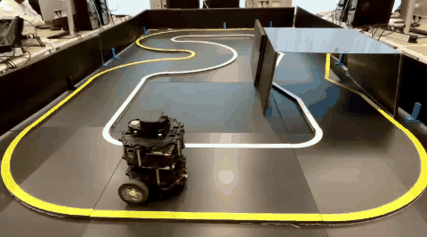
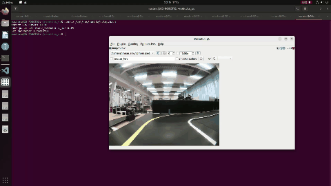

# Tb3-lane-follower — Robotics Project

Camera-only autonomous lane following for a TurtleBot3 (ROS2 Humble, Ubuntu 22.04).

| Part | Topic | Status |
|------|-------|--------|
| Part 1 | Lane following between a yellow and a white line | Done |
| Part 2 | Coming soon | Planned |

---

# Part 1 — Lane following

Yellow line on the LEFT, white line on the RIGHT; the robot drives between them.
All image processing runs on the remote PC (not the Pi).

```
Pi camera --/camera/image_raw/compressed--> [lane_follower node on PC] --/cmd_vel--> TurtleBot3
```

## Demo

Robot following the line on the track:



Detection view (rqt):



Full-quality videos: [robot on track](media/part1_robot_on_track.mp4) · [detection view](media/part1_rqt_view.mp4)

## How it works

1. `lane_detector.py` – brightness normalisation, HSV thresholds for yellow/white below the horizon,
   glare-blob removal, largest connected piece per colour, lane centre in a band near the bottom.
2. `controller.py` – PD steering on the lane-centre error; slows down in corrections.
3. `lane_follower_node.py` – ROS2 wiring, watchdog (stops if no images / lane lost), debug image.

## Hardware

- TurtleBot3 Burger with Raspberry Pi and Pi camera (ov5647)
- School PC running ROS2 Humble, same network, `ROS_DOMAIN_ID=30`

## Install (PC)

```
mkdir -p ~/robotics_ws/src && cd ~/robotics_ws/src
git clone https://github.com/petrick001/Tb3-lane-follower.git tb3_lane_follower
cd ~/robotics_ws && colcon build --packages-select tb3_lane_follower
```

## Run

Open one terminal per step and keep them open. Start in this order.

**1. Robot bringup (Pi, over ssh)**

```
ssh ubuntu@<PI_IP_ADDRESS>
source /opt/ros/humble/setup.bash
export ROS_DOMAIN_ID=30
export TURTLEBOT3_MODEL=burger
export LDS_MODEL=LDS-01
ros2 launch turtlebot3_bringup robot.launch.py
```

**2. Camera (Pi, second ssh terminal)**

```
source /opt/ros/humble/setup.bash
export ROS_DOMAIN_ID=30
ros2 run camera_ros camera_node --ros-args -p format:=BGR888
```

**3. Check the images arrive (PC)**

```
source /opt/ros/humble/setup.bash
export ROS_DOMAIN_ID=30
ros2 topic hz /camera/image_raw/compressed
```

**4. Lane follower (PC)**

```
pkill -f lane_follower
cd ~/robotics_ws
source /opt/ros/humble/setup.bash && source install/setup.bash
export ROS_DOMAIN_ID=30
ros2 launch tb3_lane_follower lane_follower.launch.py
```

Use `pkill` first so that no old copy is running: duplicate nodes send zero commands and the robot will not move.

First test: add `enabled:=false` to the launch command (the robot cannot move, detection only).
Put the wheels off the ground before enabling the movement. Stop any time with Ctrl+C
(the node sends a zero command on exit).

**5. See the detection (PC, optional)**

```
ros2 param set /lane_follower show_window true
```

**Stop:** Ctrl+C in the lane follower terminal, then the camera, then the bringup.

If your camera has no compressed topic: set `use_compressed: false` and
`image_topic: /camera/image_raw` in `config/lane_follower.yaml`.

## Known issue: viewer pauses

The debug window and `rqt` are drawn in the same step that reads each camera frame.
When the viewer is slow, a frame arrives late and the watchdog stops the robot.
Workaround: use only one viewer at a time, and raise the timeout:

```
ros2 param set /lane_follower image_timeout 1.5
```

## Live tuning (no rebuild)

```
ros2 param set /lane_follower kp 1.5        # steering gain
ros2 param set /lane_follower v_max 0.15    # top speed (m/s)
ros2 param set /lane_follower white_v_min 150
```

| Symptom                                         | Change                                                                      |
| ----------------------------------------------- | --------------------------------------------------------------------------- |
| Turns the wrong way                             | check `yellow_on_left`; sign of the error is tested in `test/test_logic.py` |
| Oscillates left-right                           | lower `kp`, raise `kd`, raise `smooth` toward 0.3                           |
| Reacts too slowly in curves                     | raise `kp`, lower `v_max`                                                   |
| Misses the white line                           | lower `white_v_min`; check the debug image                                  |
| Sees white where there is none (windows, tiles) | raise `white_v_min`, raise `roi_top`                                        |
| Drives off when only one line is visible        | tune `half_lane` (half lane width / image width)                            |

## Test without a robot

```
python3 tools/test_on_dataset.py /path/to/turtlebot3_autorace_dataset .   # stats + montage.jpg
python3 -m pytest test/ -q
```

On the course dataset (334 images, lights on/off, floor/table, both directions) the detector finds
both lines in 278 images, one line in 53, and none in 3.

---

# Part 2 — Coming soon

---

## Acknowledgements

Written with the help of an AI assistant (Claude, Anthropic). Detector thresholds were checked on the
course dataset provided by J. Rodriguez.
